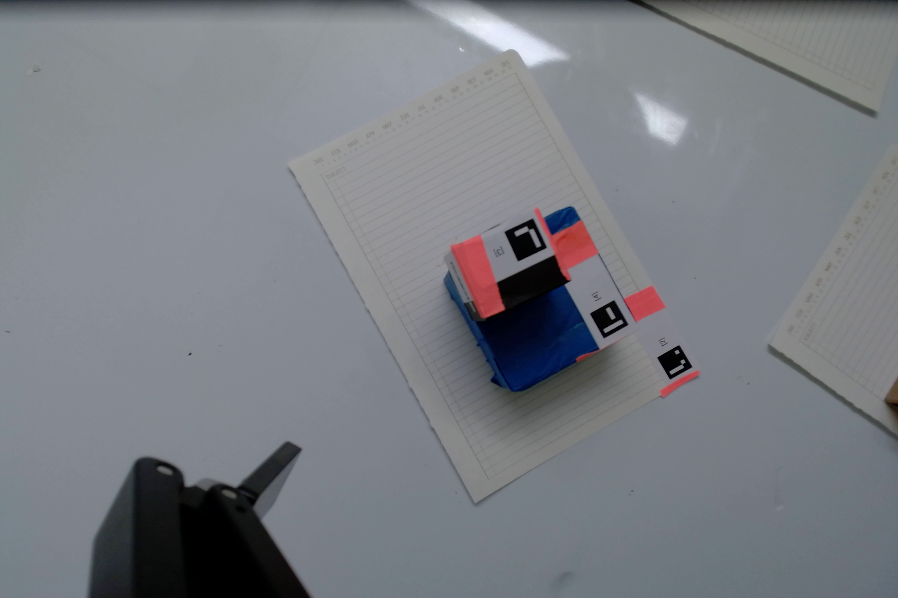
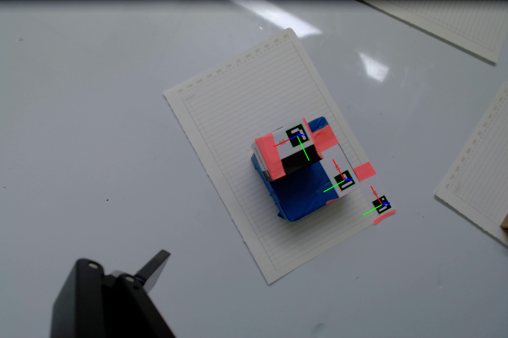

# Robotic-Tower-of-Hanoi

A vision-based pick-and-place project for **Caltech ME 235b**, implemented on a **Universal Robots UR10e** arm with a **Robotiq parallel-jaw gripper**. We used ArUco markers to locate blocks, calculate grasp poses, and attempt a three-block Tower of Hanoi.

## Project outline

1. Detect ArUco markers and estimate their 3D poses from camera images.
2. Transform marker poses into the robot's base frame using camera calibration and forward kinematics.
3. Calculate top-down grasp poses from block geometry and marker locations.
4. Scan the workspace, pick and place blocks, and execute a recursive Tower of Hanoi sequence.

## Object detection and pose estimation

We used OpenCV's ArUco detector and `solvePnP` (`SOLVEPNP_IPPE_SQUARE`) to estimate the position and orientation of each 2 cm marker. The code converts these estimates to 4 × 4 transformation matrices. For the wrist-mounted camera, it uses the UR10e's forward kinematics and the camera mounting offset to express marker poses in the robot base frame:

$$
T_{\mathrm{base,tag}} = T_{\mathrm{base,5}}\,T_{\mathrm{5,camera}}\,T_{\mathrm{camera,tag}}.
$$

| Original image | ArUco detections and pose axes |
| --- | --- |
|  |  |

The test image contains markers **3, 4, and 2**, all detected by the program.

## Grasping and Tower of Hanoi

`get_grasp_pose()` uses the known marker position and block width to estimate the block center, then positions the gripper above it with its tool axis pointing down. The robot approaches, closes the gripper, lifts the block, and moves it to a target location.

The `HanoiSolver` class scans from preset robot configurations, stores detected block and tower poses, and generates the standard recursive seven-move solution for three blocks. It tracks which blocks should be on each tower as moves are executed.

The grasp planner offsets each detected tag by half the block width to find the block center and builds a downward-facing gripper rotation matrix from the marker axes. During execution, the solver estimates stack height from known block dimensions rather than relying on noisy visual depth, then uses Cartesian moves for approach, pickup, transfer, and release.

**Results:** The UR10e was able to pick up blocks and move them approximately to the intended locations, but we did not complete the puzzle. Placement height and lateral grasp offsets needed tuning, and the physical execution followed an incorrect block sequence. The recursive sequence itself is implemented and has a separate test in the code.

## Repository contents

| File | Contents |
| --- | --- |
| [`235lab3.py`](235lab3.py) | ArUco detection, pose transforms, grasp planning, Hanoi solver, and tests |
| [`images/`](images/) | Original and annotated camera images |
| [`ME_235_Lab_3.pdf`](ME_235_Lab_3.pdf) | Lab report and results |
| [`README.md`](README.md) | Project overview and documentation |

## Authors

**Rupali Batta and Sophie Stevens**  
California Institute of Technology, **ME 235b**
